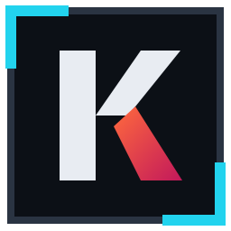
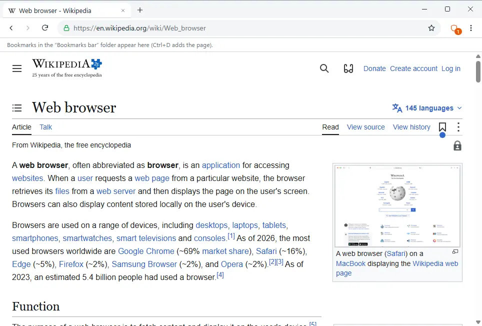
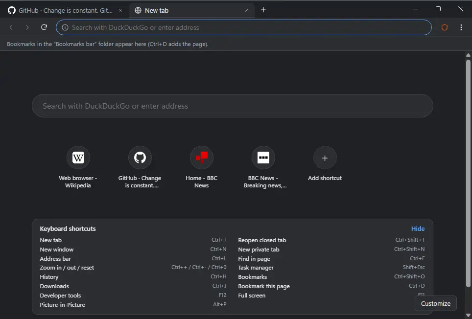
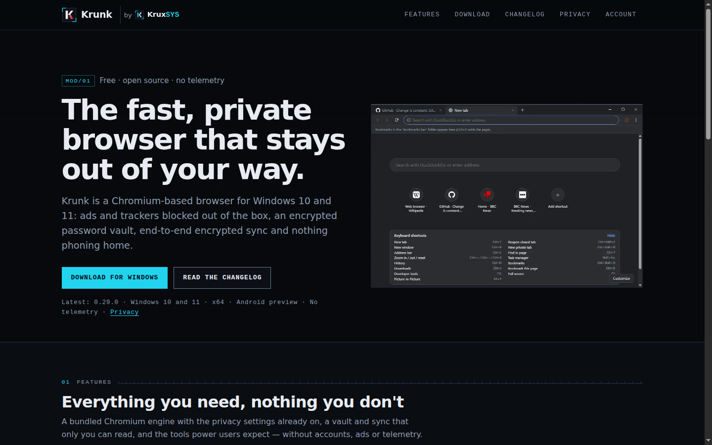

<!-- Brand: KruxSYS palette and marks, see assets/brand/README.md. -->
<p align="center">
  
</p>

<h1 align="center">Krunk</h1>

<p align="center">
  <a href="https://kruxsys.com/"></a>
  &nbsp;by <a href="https://kruxsys.com/"><b>KruxSYS</b></a>
</p>

<p align="center"><b>A lightweight, privacy-minded web browser for Windows and Android.</b></p>

<p align="center">
  <a href="https://kruxsys.com/projects/krunk/"></a>
  <a href="https://krunk.kruxsys.com/download"></a>
  <a href="https://krunk.kruxsys.com/download"></a>
  <a href="https://kruxsys.com/projects/krunk/"></a>
  <a href="https://kruxsys.com/"></a>
  <a href="https://krunk.kruxsys.com/download"></a>
  
  
  
</p>

<p align="center">
  <a href="https://krunk.kruxsys.com/">Website</a> ·
  <a href="https://krunk.kruxsys.com/download">Download</a> ·
  <a href="https://krunk.kruxsys.com/changelog">Changelog</a> ·
  <a href="https://krunk.kruxsys.com/privacy">Privacy</a> ·
  <a href="https://kruxsys.com/projects/krunk/">Project page</a> ·
  <a href="https://kruxsys.com/">kruxsys.com</a>
</p>

**Krunk** is a free, lightweight, privacy-minded web browser for Windows 10/11 (x64), made by
[KruxSYS](https://kruxsys.com/) and written in Rust. It brings its own engine, **Chromium 156.0.8078.80** through
the Chromium Embedded Framework (**CEF 156.0.15**), so neither Microsoft Edge nor WebView2 is used. It installs per
user without administrator rights or runs portable from a zip, keeps itself up to date with signed updates, and sends
no telemetry. **Krunk for Android** (preview) shares the same Rust core and syncs with it. This repository also holds
the **Krunk service**, the Docker Compose stack behind <https://krunk.kruxsys.com>: the website, downloads, signed
updates and the end-to-end encrypted account sync.

<table>
  <tr>
    <td></td>
    <td></td>
  </tr>
</table>

> **Status (Windows 0.30.2, Android 0.15.0):** Krunk for Windows is stable and in daily use; every release is
> cross-built on Linux and smoke-tested on a Windows 11 VM. Krunk for Android is a preview (phones, tablets and
> Android TV). What is not done or not verified is listed under [Known limitations](#known-limitations).
> Release notes: [`CHANGELOG.md`](CHANGELOG.md) and [`CHANGELOG-android.md`](CHANGELOG-android.md).

## What it does

- **Tabs and windows**: tabs and private tabs in as many windows as you like; drag tabs between windows, tab
  previews, session restore and background-tab sleep to save memory.
- **History and bookmarks**: a bookmarks bar with folders, and an address bar with suggestions and inline completion.
- **New-tab page**: your most-visited sites, built-in wallpapers and your own colours.
- **Ad and tracker blocking**, built in, with your own filters and filter lists.
- **Password vault**: encrypted logins and payment cards, strong-password suggestions and an optional recovery phrase.
- **Krunk account and sync**: end-to-end encrypted bookmarks, history, settings, open tabs and (with the vault
  unlocked) passwords, between your computers and Krunk for Android.
- **Chrome extensions** from the Chrome Web Store (Krunk's own Manifest V3 runtime).
- **VPN for Krunk only**: WireGuard and OpenVPN files from your provider, with a kill switch.
- **Casting** to Chromecast, Google TV, Cast speakers and DIAL TVs: a tab, or just its video; sites' own cast
  buttons work too.
- **Tools**: downloads (in parts, resumable), find, zoom, print, DevTools docked next to the page, a page-source
  viewer and a WASM memory inspector.
- **Optional AI agent**, userscripts and macros: off by default, with your own provider and key.

## Contents

- [Install, update and uninstall](#install-update-and-uninstall)
- [Krunk for Android (preview)](#krunk-for-android-preview)
- [Repository layout](#repository-layout)
- [The service](#the-service)
- [Building from source](#building-from-source)
- [Documentation](#documentation)
- [Known limitations](#known-limitations)
- [Third-party components](#third-party-components)
- [Brand](#brand)
- [Other KruxSYS projects](#other-kruxsys-projects)

## Install, update and uninstall

Download from **[krunk.kruxsys.com/download](https://krunk.kruxsys.com/download)** (Windows 10/11, 64-bit; no
runtime needed). The files are not code-signed, so SmartScreen may warn on first start (*More info → Run anyway*);
`SHA256SUMS` next to the downloads lists every file's SHA-256.

| | **Installer** `Krunk-Setup-<ver>.exe` | **Portable zip** `Krunk-win-x64.zip` |
|---|---|---|
| Installs to | `%LOCALAPPDATA%\Programs\Krunk`, per user, no admin rights | Any folder: unzip and run `Krunk.exe` |
| Your data | `%LOCALAPPDATA%\Krunk` (history, bookmarks, settings, vault, engine profile, logs) | the same folder |
| Start Menu, Installed apps | yes, plus an optional desktop shortcut | no |
| Updates | signed update check, then **Update now** installs silently and restarts with your tabs | the update notice opens the download page |
| Uninstall | Settings → Apps; keeps your data unless you tick "Also delete my Krunk data" | delete the folder |

**Updates.** Ten seconds after start and then once a day Krunk fetches `latest.json` and its Ed25519 signature from
krunk.kruxsys.com, with only `Krunk-Update/<version> (win-x64)` as user agent: no ID, nothing about your browsing.
An installer runs only if the signature, size and SHA-256 match; there are no downgrades. Switch the automatic
check off in Settings → About. Details: [How it works → Updates](docs/HOW-IT-WORKS.md#updates).

Delete `%LOCALAPPDATA%\Krunk` to reset the browser completely. Everything about the data folder, moving from
LightBrowser or older Krunk versions, and every built-in `krunk://` page is in the
[user guide](docs/USER-GUIDE.md).

## Krunk for Android (preview)

Krunk for Android (0.15.0) runs on phones and tablets with Android 8 or later (`arm64-v8a`, plus an `armeabi-v7a`
APK for 32-bit TVs) and on Android TV / Google TV. It is built from `android/` and `ffi/` on GeckoView and shares
Krunk's Rust `core` with the Windows app: the same address-bar rules, database layout and session format. It has
built-in uBlock Origin, the password vault with strong-password suggestions, the VPN, and sign-in and end-to-end
encrypted sync with the same Krunk account.

The signed APKs are on the [download page](https://krunk.kruxsys.com/download). Their certificate's SHA-256 is
`C9:4B:89:15:CD:8B:39:3A:5F:C4:8B:C1:32:A6:DE:02:63:74:E7:63:37:C4:34:1C:59:DD:60:32:83:73:E6:24`, and later
releases install over earlier ones and keep your data. Settings › About › **Check for updates** only checks when
you tap it. Full description: [`docs/ANDROID.md`](docs/ANDROID.md); feature by feature:
[`docs/ANDROID_FEATURES.md`](docs/ANDROID_FEATURES.md); building and signing:
[`docs/ANDROID_DEV.md`](docs/ANDROID_DEV.md); release notes: [`CHANGELOG-android.md`](CHANGELOG-android.md).

## Repository layout

| Path | What |
|---|---|
| `app/` | The Windows browser (`Krunk.dll`): windows, tabs, the engine host (CEF), the UI bridge, updates |
| `core/` | Platform-independent Rust core shared with Android: address bar, database, session, ad blocking, vault, sync client |
| `ui/` | Krunk's own pages and browser chrome (`shell/`, `pages/`, `shared/`, `inject/`) and the UI test harness (`dev/`) |
| `vpn/`, `vendor/` | The in-browser VPN (WireGuard via `boringtun`, OpenVPN 3 Core vendored) |
| `ffi/` | UniFFI bindings of `core` for Android |
| `android/` | Krunk for Android and Android TV (Kotlin, GeckoView, Gradle) |
| `server/` | The account and sync API (Rust), its migrations and Playwright end-to-end tests |
| `dist/server/` | The service stack: `compose.yaml`, the Caddy image, the website (`site/`), publish and backup scripts |
| `installer/` | The NSIS installer script |
| `scripts/` | `build-dist.sh` (build and package), `fetch-cef.sh`, `cef-build/` (Krunk's own CEF/Chromium build and patches), filter list updates, Windows VM test harness (`vm*.ps1`, `vm.sh`) |
| `tools/` | `pebrand` (exe version info), `framecap`, `sync-cli`, `vpn-testbed` |
| `assets/` | Brand marks and icons (`brand/`), filter lists, the update signing public key |
| `docs/` | The documentation (see [Documentation](#documentation)) and screenshots |
| `compose.yaml`, `service.json` | The service entry point for ai-pipe (includes `dist/server/compose.yaml`) |

## The service

<p align="center">
  
</p>

```
               ┌──────────────────────────── compose network ─────────────────────────────┐
 browser/app ─▶│ web (Caddy, :8080) ── /api/ ──▶ api (Rust: account, sync)                │
               │   site, /changelog, /download/,      │        ▲                          │
               │   /updates/ ◀── krunk-releases (ro)  ▼        │ keys                     │
               │                        db (PostgreSQL 18)   secrets ──▶ krunk-secrets    │
               │                           ▲                                              │
               │                        backup (daily pg_dump, 14 days) ──▶ krunk-backups │
               └──────────────────────────────────────────────────────────────────────────┘
```

- **web** is the entry service: Caddy serves the website, the changelog generated from `CHANGELOG.md`, the
  downloads and the signed update manifests from the `krunk-releases` volume (read-only), and proxies `/api/`. It
  keeps no access log and works without `api`.
- **api** is the Krunk account and end-to-end encrypted sync API; **db** is PostgreSQL; **secrets** creates the
  database password and server keys once in a volume (nothing secret is in `.env`, git or the images); **backup**
  makes a daily `pg_dump`, kept for 14 days.
- No host ports are published; ai-pipe (or your own reverse proxy) publishes `web:8080`. Operator settings
  (Turnstile, SMTP, `PUBLIC_BASE_URL`) go into `.env` (see `.env.example`).

Running it yourself, publishing Windows and Android releases (`publish-release.sh`, `publish-android.sh`), the release
key, backup and restore and the API are described in [`dist/server/README.md`](dist/server/README.md). The sync
design: [`docs/sync/`](docs/sync/PLAN.md) (plan, protocol, threat model).

## Building from source

The Windows release is cross-built on Linux for `x86_64-pc-windows-msvc` with `cargo-xwin`, using Krunk's own build
of CEF/Chromium with the proprietary codecs (pinned in `cef.lock`, SHA-256 checked, never committed):

```sh
scripts/build-dist.sh            # -> dist/Krunk-win-x64/, the zip, Krunk-Setup-<version>.exe, SHA256SUMS
scripts/build-dist.sh --fast     # quick test build, no installer or zip -> target/fast-dist/
cargo test --workspace           # core unit tests
cargo clippy --workspace --all-targets -- -D warnings
```

Requirements, toolchain versions, reproducibility, updating the engine and every check:
[`docs/BUILDING.md`](docs/BUILDING.md). Android: [`docs/ANDROID_DEV.md`](docs/ANDROID_DEV.md).

## Documentation

| Page | What |
|---|---|
| [User guide](docs/USER-GUIDE.md) | Install, data folder, migration, and how to use every part of Krunk for Windows |
| [How it works](docs/HOW-IT-WORKS.md) | Architecture, engine and processes, ad blocking, privacy, account, sync, vault, VPN, updates, memory |
| [Krunk for Android](docs/ANDROID.md) | The Android and Android TV preview |
| [Building from source](docs/BUILDING.md) | Cross-build, engine updates, checks, Windows test machine |
| [Known limitations](docs/KNOWN-LIMITATIONS.md) | The full list |
| [Security](docs/SECURITY.md), [Network](docs/NETWORK.md), [Tracking protection](docs/TRACKING_PROTECTION.md) | What Krunk protects, every connection it makes, how blocking works |
| [Extensions](docs/EXTENSIONS.md), [WASM inspector](docs/WASM_INSPECTOR.md), [DPI](docs/DPI.md) | Feature notes |
| [Manual test](docs/MANUAL_TEST.md) | The release checklist |
| [`CHANGELOG.md`](CHANGELOG.md), [`CHANGELOG-android.md`](CHANGELOG-android.md) | Release notes, also at [krunk.kruxsys.com/changelog](https://krunk.kruxsys.com/changelog) |

## Known limitations

The main ones; the full list is in [`docs/KNOWN-LIMITATIONS.md`](docs/KNOWN-LIMITATIONS.md).

- **Unsigned:** the binaries are not code-signed, so SmartScreen may warn on first start. Updates are protected by
  Krunk's own Ed25519 signature instead.
- **Engine security fixes** reach users only through new Krunk releases (Chromium 156 in 0.30.2).
- **Speed:** Krunk's engine still runs page JavaScript and layout slower than Chrome on the same machine; the
  cross-built engine has no V8 context snapshot, and Chrome's prerendering is off in CEF.
- **Casting** was never tried with a real Cast or DIAL device; copy-protected video is mirrored, not sent as
  video. The first use shows Windows' firewall prompt.
- **The AI agent** (off by default) was tested against a mock provider only, never against a live provider or a
  vision model.
- **Krunk for Android** is a preview: see [`docs/ANDROID_FEATURES.md`](docs/ANDROID_FEATURES.md) for what is not
  there yet.

## Third-party components
- **Chromium Embedded Framework 156.0.15** and **Chromium 156.0.8078.80**: CEF is BSD-licensed
  (`licenses/CEF-LICENSE.txt` in the download). Chromium and the third-party code it contains are
  listed with their licences in `licenses/Chromium-CREDITS.html`. Since 0.5.2 the binaries are
  Krunk's own build of the unmodified CEF and Chromium sources (`scripts/cef-build/`), with
  FFmpeg's proprietary codec set (H.264, AAC, HEVC, AC-3/E-AC-3 parsing) compiled in;
  `Krunk.exe` (CEF's `bootstrap.exe`) carries Krunk's version strings and manifest. Decoders
  for H.264, HEVC and AAC are covered by patent pools (MPEG LA / Via LA); licensing for
  distribution is the distributor's responsibility.
- Filter lists:
  - EasyList and EasyPrivacy: GPL-3.0-or-later or CC BY-SA 3.0.
  - uBlock Origin uAssets: GPL-3.0.
  - Attribution and licences are in `assets/filters/` and `THIRD-PARTY-NOTICES.txt`. The lists
    are used unmodified, as data.
- Rust crates: see `Cargo.lock`. The main ones are `cef` / `cef-dll-sys` (Apache-2.0 OR MIT),
  `windows` (MIT/Apache-2.0), `adblock` (MPL-2.0), `psl` (MIT/Apache-2.0), `rusqlite` with
  bundled SQLite (MIT, public domain), and RustCrypto `argon2`/`chacha20poly1305`
  (MIT/Apache-2.0). The build tool `tools/pebrand` uses `editpe` (MIT).
- **VPN (0.14.0):** OpenVPN 3 Core (MPL-2.0, used under MPL-2.0; with Asio, BSL-1.0, and LZ4,
  BSD-2) through the `openvpn-connect` crates (MPL-2.0), vendored unchanged apart from the patches
  listed in `vendor/README.md`; `boringtun` (BSD-3-Clause) and `smoltcp` (0BSD). Their notices
  are in `vpn/THIRD-PARTY-NOTICES.txt`, appended to `THIRD-PARTY-NOTICES.txt` in the download.
- **Krunk for Android:** its components and their licences (GeckoView, uBlock Origin and the
  filter lists inside it, the Android libraries) are in `android/THIRD-PARTY-NOTICES.md` and in
  the app under Settings › About. The uBlock Origin release is named in `android/ubo.lock` only.
- **No third-party editor or Markdown library (0.12.0).** The code editor of `krunk://scripts`
  (`ui/shared/editor.js`, `jstok.js`), the agent panel's Markdown renderer
  (`ui/shell/markdown.js`) and the SSE parser are Krunk's own code. Nothing new is bundled.

## Brand

Krunk is a KruxSYS product and uses the KruxSYS look: dark panels, thin blue-grey lines, a cyan signal accent,
square corners and monospace labels. The icon keeps Krunk's "K" with its orange-to-magenta lower arm inside KruxSYS's
dark square and cyan corner brackets. [`assets/brand/README.md`](assets/brand/README.md) describes the marks, and
`assets/brand/make-icons.sh` renders the app icon, the website icons and the installer art from the SVG masters.

## Other KruxSYS projects

- **[Screvia](https://kruxsys.com/projects/screvia/)**: screenshots, screen recording and sharing for Windows
  ([screvia.kruxsys.com](https://screvia.kruxsys.com/)).
- **[Plexdio](https://kruxsys.com/projects/plexdio/)**: a small, native Windows music player for Plex
  ([plexdio.kruxsys.com](https://plexdio.kruxsys.com/)).

More at [kruxsys.com](https://kruxsys.com/). Contact: [privacy@kruxsys.com](mailto:privacy@kruxsys.com)

---

<p align="center">
  <a href="https://kruxsys.com/"></a><br>
  <sub>© 2026 KruxSYS · MIT licensed · <a href="https://kruxsys.com/projects/krunk/">kruxsys.com/projects/krunk</a></sub>
</p>
