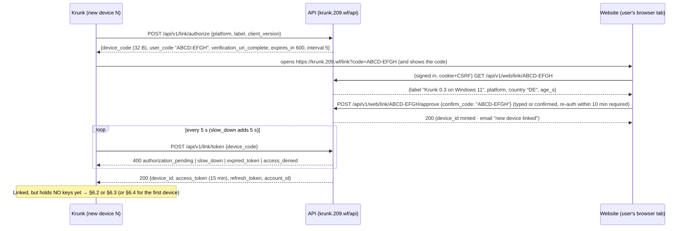
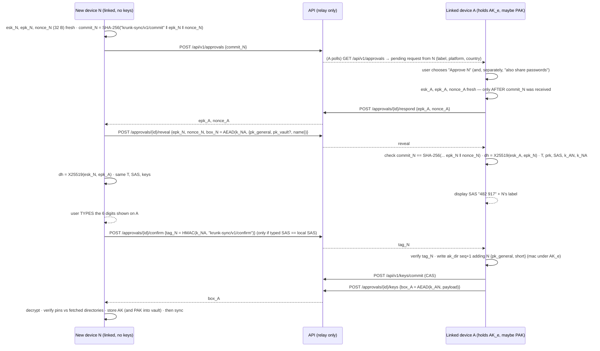
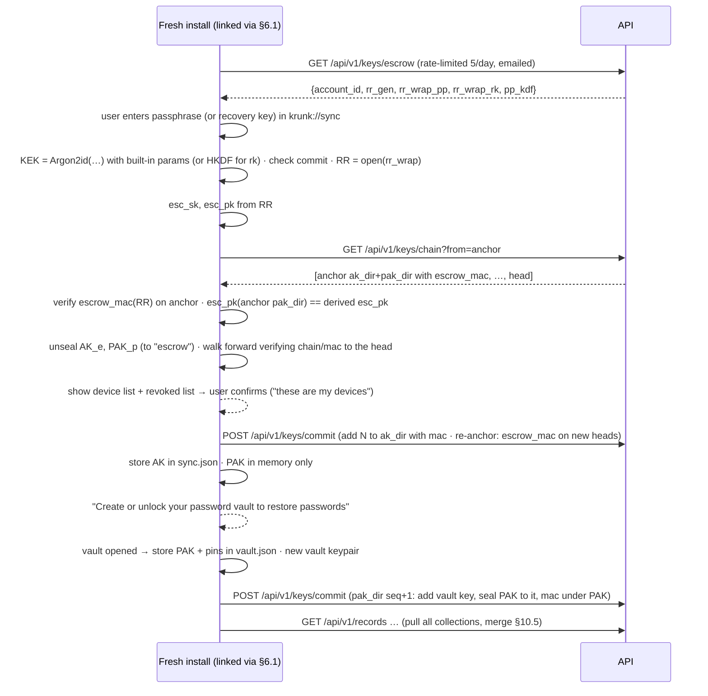
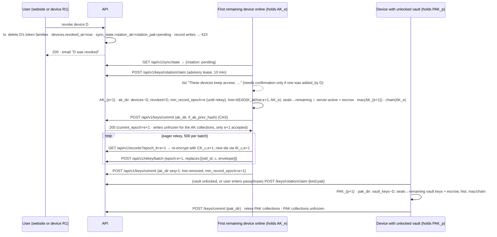

# Krunk sync protocol, v1 (design; accounts and device linking are live)

Status: proposal for operator review (2026-11-05). Implemented and live: §11.2 (S2, accounts) and §6.1, §11.3, §11.4 without `sync/state` (S3, 2026-11-09, Krunk 0.8.0). See also `PLAN.md` for architecture and milestones, `THREAT_MODEL.md` for attackers, guarantees and residuals, and `OPEN_QUESTIONS.md`.
The design was hardened by an adversarial review; its 20 findings and their resolutions are listed in the pipeline workspace (`.pipeline/sync-design-review.md`) and referenced below as **[R#]**.

Conventions: "MUST" etc. as in RFC 2119. `‖` is concatenation. `lp(x)` = 2-byte big-endian length ‖ x.
`u32be`/`u64be` are big-endian integers. JSON bytes fields are **strict** base64url without padding
(decoders reject padding, whitespace and non-canonical trailing bits) [R19]. All labels are ASCII.

---

## 1. Overview
- The **server** stores opaque ciphertext and authenticated key directories. It authenticates
  accounts (email + password) and devices (tokens). It never receives a key, a passphrase or a
  recovery key.
- The **website** (krunk.209.wf) handles registration, login, device approval of *links*, and
  device/session management. It never handles keys. Key material is entered only in the browser's
  trusted `krunk://` pages.
- The **client** (desktop now, Android later) runs the shared Rust sync core (`core::sync`).
  It encrypts every record before upload and verifies every directory before trusting a key.
- Sync is **off by default**. No request goes to any sync endpoint until the user starts
  "Link Krunk account" (PLAN §2).

## 2. Primitives
| Use | Primitive | Parameters | Crate (Rust) / Android |
|---|---|---|---|
| Record and wrap AEAD | XChaCha20-Poly1305 | 32-byte key, 24-byte random nonce (OS CSPRNG), 16-byte tag | `chacha20poly1305` 0.11 (already used by the vault) |
| Seal to a public key | HPKE base mode, RFC 9180: KEM 0x0020 DHKEM(X25519, HKDF-SHA256), KDF 0x0001 HKDF-SHA256, AEAD 0x0003 ChaCha20Poly1305 (HPKE derives its own 12-byte nonces; this is separate from the record AEAD) | `info` per §3.3, empty `aad` | `hpke = "=0.15.1"`, `default-features = false`, features `alloc`, `getrandom`, `x25519`, `chacha`. No ML-KEM, AES or NIST curves. Its dependencies are the crates already used here: `chacha20poly1305` ^0.11, `x25519-dalek` ^3, `curve25519-dalek` ^5, `hkdf` ^0.13, `sha2` ^0.11, `getrandom` ^0.4 (checked on crates.io, 2026-11-05). Android uses the same Rust core via UniFFI |
| Key derivation | HKDF-SHA256 (RFC 5869) | `salt` = account_id (16 raw bytes) unless stated; `info` = label; 32-byte output | `hkdf` 0.13 + `sha2` 0.11 |
| MAC | HMAC-SHA256 | 32-byte key, full 32-byte tag, constant-time compare | `hmac` 0.13 |
| Key agreement (device approval) | X25519 (RFC 7748), ephemeral on both sides | All-zero shared secret rejected | `x25519-dalek` 3 |
| Passphrase KDF | Argon2id v0x13 | m = 131072 KiB (128 MiB), t = 3, p = 1, 16-byte salt, 32-byte output; floors m ≥ 131072, t ≥ 3 hard-coded [R1] | `argon2` 0.6 |
| Hash | SHA-256 | – | `sha2` 0.11 |
| Random | OS CSPRNG | – | `getrandom` 0.4 |
| Encoding | base64url (no pad, strict); Crockford base32 (codes) | – | `base64ct` 1.8; `data-encoding` 2.11 |

No Windows-only primitive appears in the format. DPAPI (Windows) and Android Keystore only
protect *local* files (§8).

## 3. Identifiers, encodings, seal

### 3.1 Identifiers
- `account_id`: UUIDv4, 16 bytes, set by the server at registration. It is bound into every KDF
  salt, AAD and MAC input, so keys and ciphertexts can't be moved between accounts.
- `device_id`: UUIDv4, minted by the server **only** when a link grant is approved on the website
  (§6.1) [R3].
- `short` (`dev_short`): a u16, unique per account, used for HLC tie-breaks.
  - The server allocates it at link approval.
  - The client copies it into its `ak_dir` entry.
  - `keys/commit` rejects an `ak_dir` whose `short` values differ from the server's.
- `has_keys`: the server sets it for a device that appears in the current `ak_dir.devices`. The
  server parses `ak_dir` structurally (§11.5); it can't verify the MACs.
- Record ids: 16 bytes (§9.1).

### 3.2 Crockford base32
- Alphabet: `0123456789ABCDEFGHJKMNPQRSTVWXYZ`.
- Decoding maps `O→0` and `I/L→1`, is case-insensitive, and ignores `-` and spaces.
- Check symbol (recovery key only): value mod 37 over the alphabet plus `*~$=U` (Crockford's
  check symbols).

### 3.3 Seal (HPKE)
- `seal(pk_R, pt, info)` is HPKE `SetupBaseS(pk_R, info)` followed by `Seal(aad="", pt)`. The output is `{enc, ct}`.
- The `info` string is:
  `"krunk-sync/v1/seal" ‖ lp(kind) ‖ account_id ‖ u32be(epoch) ‖ lp(recipient_id)`
- `kind` is one of `ak`, `pak` or `ak-hist`. `recipient_id` is a device id string or `"escrow"` [R17].
- After unsealing an epoch key, the receiver MUST verify that directory's `mac` with it (key
  confirmation) before using it.

## 4. Key hierarchy and directories

### 4.1 Hierarchy
```
            passphrase (generated 6-word EFF list, ASCII)          recovery key (160-bit, Crockford)
                   │ Argon2id(pp_salt, m=128MiB,t=3,p=1)                 │ HKDF("krunk-sync/v1/rk-kek")
                   ▼                                                     ▼
                KEK_pp ────── AEAD wrap (+commit tag) ──┐   ┌── AEAD wrap ────── KEK_rk
                                                        ▼   ▼
                                           RR  recovery root (32 B, never stored on a device)
                                                        │ HKDF("krunk-sync/v1/escrow-x25519")
                                                        ▼
                                          escrow keypair (esc_sk, esc_pk)   ── esc_pk pinned in pak_dir
                                                        │ HPKE seal (kind ak / pak)
             ┌──────────────────────────────────────────┴──────────────────────────────┐
             ▼                                                                           ▼
   AK_e  account key, epoch e                                               PAK_p  passwords key, epoch p
   sealed to: every device "general" X25519 key + esc_pk                    sealed to: every device "vault" X25519 key + esc_pk
   stored: sync.json (DPAPI / Keystore-wrapped)                             stored: inside vault.json (under VK) only
     │ HKDF(salt=account_id)                                                    │ HKDF(salt=account_id)
     ├─ CK_c,e  "krunk-sync/v1/enc/<c>/<e>"   (history, bookmarks,             ├─ CK_pw,p  "krunk-sync/v1/enc/passwords/<p>"
     │           settings, tabs, lists)                                         ├─ IK_pw,p  "krunk-sync/v1/id/passwords/<p>"
     ├─ IK_c,e  "krunk-sync/v1/id/<c>/<e>"                                      ├─ K_pakmac,p "krunk-sync/v1/pak-dir-mac/<p>"
     ├─ K_akmac,e "krunk-sync/v1/ak-dir-mac/<e>"                                └─ K_pakhist,p "krunk-sync/v1/pak-hist/<p>"
     ├─ K_akhist,e "krunk-sync/v1/ak-hist/<e>"
     └─ K_name,e "krunk-sync/v1/device-name/<e>"
```
- The **PAK collections** are `passwords` and `never_save`. They are keyed **only** by PAK
  (`CK_pw,p`/`IK_pw,p` for passwords, `CK_ns,p = HKDF(PAK_p, …, "krunk-sync/v1/enc/never_save/<p>")`
  and `IK_ns,p` likewise for the never-save list). AK never derives a key for them. "Passwords
  sync only while the vault is unlocked", the PAK freeze (§7 step 7) and the PAK rekey all apply
  to both collections.
- Device "general" key: a random X25519 keypair in `sync.json`. Device "vault" key: a random
  X25519 keypair stored inside `vault.json` (§8).

### 4.2 `ak_dir`, the account directory [R2]
- **Bytes:** UTF-8 JSON, stored and MAC'd as exact bytes. The server never re-serializes it.
  ```json
  {"v":1,"account_id":"<b64>","epoch":3,"seq":17,"prev_hash":"<b64 SHA-256 of previous ak_dir bytes, or empty at seq 1>",
   "devices":[{"id":"<uuid>","short":2,"pk":"<b64 X25519>","added_by":"<uuid>","added_seq":9}],
   "revoked":["<uuid>"], "min_record_epoch":3,
   "seals":[{"to":"<uuid>|escrow","enc":"<b64>","ct":"<b64>"}],
   "hist":{"epoch":2,"n":"<b64>","ct":"<b64>"},
   "created_ms":1793840000000,"created_by":"<uuid>"}
  ```
- **Tags:**
  - `mac = HMAC(K_akmac,epoch, bytes)` (always);
  - `chain = HMAC(K_akmac,epoch-1, bytes)` (only when `epoch` > previous epoch);
  - `escrow_mac = HMAC(HKDF(RR, account_id, "krunk-sync/v1/escrow-mac/ak"), bytes)` (only on escrow-anchored versions, §5.4).
- **`hist`** is `AEAD(K_akhist,epoch, AK_{epoch-1}, aad = "krunk-sync/v1/ak-hist" ‖ account_id ‖ u32be(epoch))`.
  It lets a holder of the head key read records that have not yet been rekeyed. It is removed when
  the rekey completes.

### 4.3 `pak_dir`, the passwords and escrow directory [R1][R2]
- **Bytes:**
  ```json
  {"v":1,"account_id":"<b64>","pak_epoch":2,"seq":5,"prev_hash":"<b64>",
   "pp_kdf":{"alg":"argon2id","m_kib":131072,"t":3,"p":1,"salt":"<b64 16B>"},
   "esc_pk":"<b64>", "rr_gen":1,
   "vault_keys":[{"device":"<uuid>","pk":"<b64 X25519>"}],
   "seals":[{"to":"<uuid>|escrow","enc":"<b64>","ct":"<b64>"}],
   "hist":{"pak_epoch":1,"n":"<b64>","ct":"<b64>"},
   "created_ms":…,"created_by":"<uuid>"}
  ```
- **Tags:**
  - `mac = HMAC(K_pakmac,pak_epoch, bytes)`;
  - `chain = HMAC(K_pakmac,pak_epoch-1, bytes)` on a PAK epoch change;
  - `escrow_mac` with label `.../escrow-mac/pak`.
- **`hist`** is `AEAD(K_pakhist,pak_epoch, PAK_{pak_epoch-1}, aad = "krunk-sync/v1/pak-hist" ‖ account_id ‖ u32be(pak_epoch))`,
  the same shape as `ak_dir`'s.
- Devices **without PAK** store `pak_dir` as opaque bytes and send it back byte-identical. They
  never seal anything to keys listed in it.

### 4.4 Acceptance rules (normative) [R1][R2][R3][R7][R14]
1. Both blobs: check `v == 1` and `account_id` before anything else, and verify the MACs in
   constant time before acting on any field.
2. **`ak_dir`** (every device): accept only if
   - `seq` is greater than the stored high-water mark, and
   - `prev_hash` equals SHA-256 of the accepted head (or the blob is reached by a contiguous,
     verified chain from it);
   - **same epoch:** `mac` verifies under the held `AK_e`;
   - **epoch e+1:** `chain` verifies under `AK_e`, then the device unseals its own seal, then
     `mac` verifies under `AK_{e+1}`. Epochs are never skipped (walk the chain).
3. **Forks:** different bytes at an already accepted `seq`, or a `prev_hash` mismatch, are a fork.
   The client stops all writes and shows a security alert.
4. **Self-revocation:** if its own id is absent from `devices`, or listed in `revoked`, the
   client wipes its sync keys and state.
4a. **Sync reset:** `sync/state` carries `keyset_gen`, a UUID that changes only on
    `web/sync/reset`. A device that sees a new `keyset_gen` does **not** raise a fork alarm.
    - It asks: "Sync data was reset on the website. Set up keys again?"
    - After confirmation it drops its keys, pins and high-water marks, keeping local data, and
      starts §6.4 (or §6.2/§6.3 if another device has already set up).
    - A server that fakes a reset gains nothing: new keys are created on the client.
5. **`pak_dir`** (PAK holders only): the same rules with the PAK keys. Additionally:
   - `pp_kdf` must meet the hard-coded floors;
   - `esc_pk` must equal the device's pinned `esc_pk`, unless the change comes with an
     `rr_gen` increment in a PAK-authenticated blob (§5.3);
   - the device seals PAK only to `vault_keys` whose device is active in the accepted `ak_dir`,
     and to the pinned `esc_pk`.
6. **Pins** [R5][R10]:
   - set at link from the device-approval payload (head hashes, epochs, `esc_pk`, §6.2);
   - set at restore from RR (`esc_pk` re-derived and compared, §6.3);
   - PAK-level pins (the `pak_dir` head hash and seq, `pak_epoch`, `esc_pk`, `rr_gen`) live in
     `vault.json` under VK; AK-level marks live in `sync.json`.
7. **Seal targets** on any write: (`ak_dir.devices` − `revoked`) ∩ the server's active device
   list (`GET /api/v1/devices`). A device the server doesn't know is never sealed to.

## 5. Escrow: passphrase, recovery key, recovery root

### 5.1 Passphrase
- **Default:** Krunk generates 6 words from the EFF large wordlist (7776 words, 77.5 bits),
  lowercase ASCII, separated by `-` [R9].
- **Custom passphrases:** allowed only if they are ASCII, at least 16 characters, and the
  `zxcvbn` estimate is ≥ 10^17 guesses (about 2^56). The UI warns if one equals the account
  password; the website can't check that.
- **Where it may be entered:** only in `krunk://sync` (the trusted UI). The UI shows the
  canonical warning: **"The Krunk website never asks for your sync passphrase or recovery key."**
- **Derivation:** `KEK_pp = Argon2id(passphrase bytes, salt=pp_kdf.salt, m=131072 KiB, t=3, p=1, len=32)`.
  The client uses the built-in constants. A server or `pak_dir` value below the floor is
  rejected, and re-wraps always use the constants [R1].

### 5.2 Recovery key
- 20 random bytes, encoded as Crockford base32 (32 symbols) plus 1 check symbol and shown as
  `KRNK-XXXX-XXXX-XXXX-XXXX-XXXX-XXXX-XXXX-XXXX-C`.
- It is shown **once**, with Save/Print. The user must type the last 4-symbol data group back
  (not the check symbol) to confirm it was saved.
- **Derivation:** `KEK_rk = HKDF(ikm=rk_bytes, salt=account_id, info="krunk-sync/v1/rk-kek")`.

### 5.3 Recovery root (RR) [R8][R18]
- **RR:** 32 random bytes. It is never written to disk on a device; it lives in memory only during setup, restore, passphrase change or re-anchoring.
- **Wraps** (each 48 bytes of ciphertext):
  ```
  rr_wrap_X = { n: 24 B, ct: AEAD(KEK_X, n, RR, aad="krunk-sync/v1/rr/<X>" ‖ account_id ‖ u32be(rr_gen)),
                commit: HMAC(HKDF(KEK_X, account_id, "krunk-sync/v1/rr-commit/<X>"), account_id ‖ u32be(rr_gen)) }
  ```
  `X` is `pp` (passphrase) or `rk` (recovery key). The client checks `commit` first, then requires a ciphertext of exactly 48 bytes, then decrypts.
- **Escrow keypair:** `esc_sk = HKDF(RR, account_id, "krunk-sync/v1/escrow-x25519")` (clamped
  by X25519); `esc_pk` is its public key.
- **Changing the passphrase, regenerating the recovery key, or "my passphrase may have leaked"**
  all **rotate RR** [R8]:
  1. Create RR′ and `rr_gen + 1`.
  2. Wrap RR′ under the new passphrase and a **new** recovery key (show it).
  3. Derive `esc_pk′`.
  4. Reseal the current AK and PAK to `esc_pk′`.
  5. Write `pak_dir` (with `esc_pk′`, `rr_gen + 1`, `mac`) and `ak_dir` (escrow seal replaced),
     both escrow-anchored under RR′.

  The device must hold PAK, which it unseals from the old escrow with the old passphrase. In the
  "leaked" case it also rotates AK and PAK (§7).

### 5.4 Escrow anchor
- An **anchor** is an (`ak_dir`, `pak_dir`) pair carrying `escrow_mac` tags, written by a party
  holding RR: at setup, restore, re-anchor and RR rotation.
- Restorers start from the latest anchor and walk forward under §4.4. Existing devices never
  need `escrow_mac` [R20].

## 6. Flows

### 6.1 Link (device grant, modelled on RFC 8628)
This is the OAuth 2.0 Device Authorization Grant used as a pattern, not full OAuth.


- **`user_code`:** 8 Crockford symbols (40 bits) from the OS CSPRNG, shown as `XXXX-XXXX`.
- **`device_code`:** 32 random bytes. The server stores only HMAC hashes of both codes.
- **Lifetime:** 10 minutes, single use.
  - An approved grant is deleted once its tokens have been issued.
  - A denied or expired grant is deleted once that answer has reached a poll.
  - Every grant is deleted by `expires_at` + 10 minutes at the latest.
- **Polling:** at least 5 s apart. Faster polling returns `slow_down` (+5 s).
- **Brute force:** at most 5 `user_code` lookups (successful or not) per web session per 10
  minutes, and 20 per IP per hour. 40 bits of entropy against those limits make guessing a live code negligible.
- **Phishing mitigations:**
  - The approval page shows the device label, platform, the requesting IP's country
    (`CF-IPCountry`) and the age of the request.
  - It warns "Only approve if you started this on your own device just now", and a mismatch in
    country is highlighted.
  - The user must click **Approve this device** after re-typing or checking the code.
  - An email goes out for every approved link.
  - A link grant gives **no keys**: an attacker who phishes an approval gets ciphertext and
    metadata access only, and is visible in the device list as "no keys" (§11.6).

### 6.2 Device approval: key transfer from a linked device A to a new device N [R4][R5][R6]

- **Transcript** (every field length-prefixed with `lp`):
  `T = "krunk-sync/v1/approve" ‖ account_id ‖ approval_id ‖ dev_id_A ‖ dev_id_N ‖ SHA-256(lp(N label) ‖ lp(platform)) ‖ commit_N ‖ epk_A ‖ nonce_A ‖ epk_N ‖ nonce_N`
  (pinned by `core::sync::sas` and the test vectors).
- **Keys:**
  - `prk = HKDF-Extract(salt = SHA-256(T), ikm = dh)`;
  - `SAS = u64be(HKDF-Expand(prk, "krunk-sync/v1/sas", 8)) mod 10^6`, shown as `NNN NNN`;
  - `k_AN = HKDF-Expand(prk, "krunk-sync/v1/k-an", 32)`;
  - `k_NA = HKDF-Expand(prk, "krunk-sync/v1/k-na", 32)`.

  Nonces for `box_N` and `box_A` are 24 random bytes (XChaCha20-Poly1305), with
  AAD = `"krunk-sync/v1/box"` ‖ direction byte.
- **Why this is MITM-safe:**
  - A picks its ephemeral key and nonce only after seeing `commit_N`, and N is bound by the
    commitment, so a relaying server can't grind for an SAS collision. One attempt has a 10^-6
    chance.
  - Each approval allows exactly one attempt. A mismatch aborts it, and N must request a new
    approval.
  - At most 5 approvals per account per day, each one emailed.
- **`payload`:**
  ```json
  {"ak":"<b64>","epoch":e,"ak_dir_head":"<b64 hash>","pak_dir_head":"<b64 hash>","esc_pk":"<b64>",
   "pak":"<b64>?","pak_epoch":p?,"dev_short":k}
  ```
  - `pak` is included **only** if the user ticked "also share passwords" on A **and** entered
    the master password freshly for this approval [R6].
  - N's long-term keys travel inside `box_N`, so the server can't substitute the `pk` that A
    writes into `ak_dir`.
- **What N does next:**
  1. Fetches the head directories.
  2. Checks them against the payload's head hashes and pins.
  3. Verifies the directory MACs with the received keys.
  4. Stores AK in `sync.json`.
  5. If it received PAK: stores PAK inside its vault (create or unlock first). Then adds its
     `vault_keys` entry by writing `pak_dir` seq+1 with a `mac` under PAK and a seal of PAK to
     its own vault key.

  N uploads nothing before step 3 succeeds [R5].

### 6.3 Restore on a fresh install with the passphrase or recovery key (including passwords)

**Restoring passwords:**
1. Passphrase or recovery key → RR → `esc_sk`.
2. Unseal PAK from the `escrow` seal in `pak_dir`.
3. PAK is held in memory only.
4. The vault is created or unlocked, then PAK and the pins are sealed into `vault.json` under VK.
5. A new vault keypair is registered in `pak_dir`.
6. The PAK collections (`passwords` with `CK_pw`, `never_save` with `CK_ns`) are pulled and
   merged into the vault, as in "Vault entries ↔ password records" (§9.5).

If Krunk exits before step 4, PAK is dropped. The user enters the passphrase again later (or uses §6.2 from a device with an unlocked vault).

### 6.4 First device (account setup)
1. Link (§6.1).
2. The server reports `keys: none` (`GET /api/v1/keys/head` returns 404 `no_keyset`).
3. In `krunk://sync` the user sees the passphrase (generated, with the option to choose one) and
   the recovery key, and confirms both.
4. The client generates RR, AK_1, PAK_1, its general and vault keypairs and `pp_salt`, then
   builds:
   - `ak_dir` seq 1 with itself, `short` 1, and seals to itself and escrow;
   - `pak_dir` seq 1 with `pp_kdf`, `esc_pk`, `rr_gen` 1 and its vault key, sealing PAK to itself and escrow;
   - both MACs plus `escrow_mac` (the anchor).
5. It uploads everything in one `POST /api/v1/keys/commit` with `if_absent: true`, together with the `rr_wrap`s. PAK goes into the vault; if there is no vault yet, the user is asked to create one, or to skip password sync.
6. It runs the first sync (§10.5).

## 7. Revocation and key rotation [R3][R11][R14]

**Normative procedure:**
1. **Revoke** (from the website or from a device). The server, in one transaction:
   - deletes all of D's access tokens and refresh-token families, and marks D revoked
     (`revoked_at`);
   - sets `sync_state.rotation_ak = pending` and `sync_state.rotation_pak = pending`;
   - returns `423 rotation_pending` for record writes from every device, and D has no tokens
     anyway. Reads stay available.
   - It also emails the user.

   If the revocation starts on a remaining device R1, R1 performs steps 2–6 right away.
2. **Who rotates:** any remaining device holding `AK_e`. It learns of the rotation from
   `GET /api/v1/sync/state`, then calls `claim`. The lease is advisory; safety comes from CAS in
   step 4.
   - The device shows the list of devices that keep access. It asks for confirmation only if a
     device in that list was `added_by` D [R3]. A revocation the user started on this same device
     never prompts again.
   - No passphrase is needed.
3. **New AK:** the device generates `AK_{e+1}` (32 random bytes) and builds `ak_dir` seq+1:
   - `epoch` e+1; `devices` minus D (and minus anything the user unticked); `revoked` + D;
   - `seals` of `AK_{e+1}` to each remaining general key (∩ the server's active list) and to `esc_pk`;
   - `hist` = `AK_e` under `K_akhist,e+1`;
   - `min_record_epoch` = e;
   - `mac` under `AK_{e+1}` and `chain` under `AK_e`.
4. **Commit:** `POST /api/v1/keys/commit {ak_dir, if_ak_prev_hash}`. The server applies it only
   if `if_ak_prev_hash` equals SHA-256 of its current head (CAS). It then sets
   `current_epoch = e+1` and lifts the freeze for the AK collections, accepting only
   `e = e+1` from then on.
   - A rotator that loses the CAS discards its key, re-reads the head and accepts the winner
     under §4.4.
   - Nobody writes records under e+1 before the commit is acknowledged.
5. **Eager rekey** (in the background, resumable by any epoch e+1 device):
   - Every record of epoch e, tombstones included, is fetched, decrypted (with `AK_e` from
     `hist`), re-encrypted under `CK_c,e+1` with its new id `HMAC(IK_c,e+1, natural_key)`, and
     sent via `POST /api/v1/rekey/batch`.
   - Each batch is atomic: insert the new records, delete the old ones.
   - The server reports the progress `remaining_old`.
6. **Old-epoch records:** the server never accepts writes with `e < current_epoch`. When
   `remaining_old == 0`, the rotator commits `ak_dir` seq+1 without `hist` and with
   `min_record_epoch = e+1`. Clients then reject any record with `e < min_record_epoch` [R11].
   Other devices see the epoch change and run a full reconcile (§10.4) to remap ids.
7. **PAK rotation:** done by the first remaining device whose vault is unlocked, after a fresh
   master-password prompt (or by an RR holder via the passphrase).
   - It generates `PAK_{p+1}`, removes D's vault key, seals to the remaining vault keys and to
     `esc_pk`, adds `hist`, `mac` and `chain`, commits by CAS and rekeys the PAK collections
     (`passwords`, `never_save`).
   - The **PAK collections** (`passwords`, `never_save`) stay frozen (423) until this commit.
     The other collections unfreeze at step 4.
8. **No other device online:**
   - Writes stay frozen and D stays locked out (no tokens). Local changes queue on each device.
   - Rotation happens when any remaining device comes online, or when the user restores a new
     device with the passphrase or recovery key. That device holds RR, gets `AK_e`/`PAK_p` from
     escrow and performs steps 2–7.
   - After a revocation the remaining devices show "Finish securing your account: enter your
     passphrase". This writes a new escrow anchor at the rotated heads, so later restores don't
     depend on the chain MAC under the revoked epoch (THREAT_MODEL R1).

## 8. Local state (clients)
**Clarified in 0.9.0 (S5).** The numbers first planned here were used by other features before
sync shipped, and the account identity arrived first (0.8.0):
- the sync schema of `browser.db` is **v6**, not v5 (v5 is 0.5.0's site permissions);
- the vault's sync field is **format 4**, not 2 (2 and 3 are 0.6.0's cards and 0.7.0's recovery
  slot);
- the account and device ids and the rotating refresh token stay in **`account.json`** (0.8.0,
  DPAPI with its own entropy). `sync.json` holds only the sync key material below, so a token
  rotation never has two copies to keep in step.

- **`sync.json`** (`%LOCALAPPDATA%\Krunk\`; app-private storage on Android) holds:
  - `account_id`, `device_id`, `dev_short` (copies, for the AAD and MACs);
  - the general X25519 private key;
  - `AK` for each epoch still needed (head + older ones while records are re-encrypted);
  - AK-level high-water marks: `ak_dir` seq and head hash, epoch, `min_record_epoch`, last pull
    `seq`, the HLC, and a fork or tamper alarm.

  Everything except `v` is sealed with XChaCha20-Poly1305 (AAD `krunk-sync-state/v1`) under a
  fresh random 32-byte state key at every save. That key is wrapped with **DPAPI** (CurrentUser,
  entropy `"Krunk sync state v1"`) on Windows, or with an **Android Keystore** AES-256-GCM key on
  Android [R19]. The file is `{v, wrap, key, n, ct}`.
- **`vault.json`**, format 4: a new optional sealed field `sync`, `AEAD(VK, …, aad="lb-vault:sync")`,
  whose hash is in the sealed manifest (an older `sync` can't be put back), holding:
  - the vault X25519 private key;
  - `PAK` (head + hist);
  - PAK-level pins: the `pak_dir` head hash and seq, `pak_epoch`, `esc_pk` and `rr_gen` [R10];
  - the queue of pending changes to the passwords (the ids of the entries changed since the last
    push), so it never sits outside the vault.
- **`browser.db`** schema v6 adds bookmark GUIDs and the sync bookkeeping tables. Their single
  definition is in PLAN §5.2.

## 9. Records

### 9.1 Envelope and AAD [R15][R16]
```json
{"v":1,"c":"bookmarks","id":"<b64 16 B>","e":4,"k":"ak","n":"<b64 24 B>","ct":"<b64>"}
```
- `id = HMAC(IK_c,e, natural_key_bytes)[0..16]`. For the PAK collections, `k = "pak"` and `e`
  means `pak_epoch`. Passwords use `CK_pw,p`/`IK_pw,p`, and the never-save list uses
  `CK_ns,p`/`IK_ns,p` (§4.1).
- `aad = lp("krunk-sync/v1/rec") ‖ u8(v) ‖ account_id ‖ lp(c) ‖ id(16 raw) ‖ lp(k) ‖ u32be(e)`.
- `ct = XChaCha20-Poly1305(CK, n, pad(plaintext_json), aad)`.
- The plaintext carries `{"ver": <u64>, "dev": <short>, "deleted": bool, "data": {…}}`. The
  version stays **inside** the ciphertext; conditional writes use the server's `seq`.

AAD binding catches cross-collection and cross-record swaps and moves between accounts and
epochs. A replay of an older ciphertext of the same record (rollback) is caught by `ver` against
the per-record high-water mark kept in `sync_items`.

**Change from the brief's baseline (version in the AAD), with justification [R16]:**
- **What changed:** the baseline binds collection + record id + version in the AAD. Here the
  version is in the *plaintext*.
- **Integrity is the same:** the AEAD authenticates the plaintext, so `ver` can't be altered,
  and rollback is still detected by the per-record high-water mark.
- **What it gains:** the server no longer learns exact per-URL visit and edit times.
- **What stays in the AAD:** collection, id, epoch, key kind and account, so swaps are still
  detected.

### 9.2 Padding
- **Scheme:** ISO/IEC 7816-4: append `0x80`, then `0x00` up to the bucket size.
- **Buckets:** 256, 512, 1024, … 65536 bytes.
- **Limit:** a plaintext over 65535 bytes is rejected locally. The server rejects ciphertext over
  65536 + 16 bytes.
- **Leak:** the server learns only the bucket.

### 9.3 Versions (HLC) [R13]
- **Format:** `ver` = 48-bit physical ms ‖ 16-bit logical counter, as a u64. The tie-break is
  `dev_short`.
- **Local clock:** the HLC never advances beyond `now + 24 h`.
- **Future records:** a record whose `ver` is more than 24 h in the future is accepted but
  clamped for merging and flagged in the log.

### 9.4 Tombstones [R12]
- **Form:** `deleted: true` with an empty `data`, a higher `ver` and the same id. It is padded to
  the **same bucket** as the record's last version (stored in `sync_items.bucket`), so the server
  can't tell a deletion from an edit by its size.
- **Retention:** the server can't tell a tombstone from any other record (`deleted` is inside
  the ciphertext), so **clients purge them**. A client that sees a tombstone with a `ver` older
  than 180 days sends `{c, id, if_seq, purge: true}` in `records/batch`. The server deletes the
  row and raises `purge_horizon_seq` to that record's `seq`.
- **Missing records:** a client **never** deletes a local item because a record is missing.
  Deletions arrive only as authenticated tombstones.

### 9.5 Collections, payloads and conflict rules
| Collection `c` | Key | Natural key | Payload `data` | Merge rule |
|---|---|---|---|---|
| `history` | AK | normalized URL (§9.6) | `{url, title, visits:[ms…] (≤ 20 most recent), count}` | Merge: union of visits (keep the newest 20), `count = max(local, remote, union size)`, title from the newest visit |
| `bookmarks` | AK | `guid` (16 random bytes) | `{guid, parent_guid, kind:"folder"\|"bookmark", title, url?, sort:"<fractional index>", added, modified}` | Per item, field-group LWW by `ver`: (parent, sort) as one group, (title, url) as another. The tree is repaired after every merge (below) |
| `passwords` | PAK | vault entry id (32 hex) | `{origin, username, password, note, created, updated}` | Per-entry LWW by `ver`. The losing version is kept locally for 30 days as "previous version" (inside the vault) |
| `settings` | AK | setting key | `{key, value}` (allowlisted keys, PLAN §5.5) | Per-key LWW |
| `tabs` | AK | device id | `{device, updated, windows:[{tabs:[{url,title}], active}]}` (≤ 500 tabs) | Written only by the owner. Others display it read-only. On unlink the owner writes a tombstone. On revocation the **rotator** writes tombstones for the revoked device's `tabs` and `device_meta` records during the rekey (it knows the natural key, the device id) |
| `allowlist` | AK | host | `{host, added}` | Add/remove LWW per host |
| `never_save` | PAK | origin | `{origin, added}` | Add/remove LWW (in the passwords domain, because origins reveal accounts) |
| `pins` | AK | URL | `{url, title, state:"pinned"\|"hidden", sort}` | LWW per URL |
| `device_meta` | AK | device id | `{name}` | Written by the owner or a renaming device. LWW. The server shows "Device #short" instead |
| `payments` | PAK | vault card id (32 hex) | `{number, exp_month, exp_year, name, nickname, address, created, updated}` — never a security code (0.6.0) | Per-card LWW by `ver`; a tombstone deletes the card. Same vault re-encryption and merge-back rules as `passwords` (the natural key is the card id; a remote record whose number matches a local card adopts the remote id). **Upload pending:** the sync client of PLAN S6 is not built yet; the collection, its keys and the envelope are defined and tested so that the format is fixed now |

**Vault entries ↔ password records (sync re-encryption and merge-back):**
- **Outgoing:** while the vault is unlocked, every vault change (`Vault::save_login`, `upsert`,
  `delete`) also queues the entry id inside the vault's sealed `sync` field (§8).
  - The sync job reads the decrypted `Entry` from the open vault and builds
    `{origin, username, password, note, created, updated}`.
  - It encrypts that under `CK_pw,p` (PAK) with id `HMAC(IK_pw,p, entry_id)`.
  - It zeroizes the plaintext buffer.

  The vault's own encryption (VK, AAD `lb-vault:entry:<id>`) is untouched; the record is a
  second, independent encryption under PAK.
- **Incoming:** each record is decrypted with `CK_pw,p` in memory, then:
  1. If an entry with the same id exists, per-entry LWW by `ver` applies. The loser is kept 30
     days as "previous version" inside the vault.
  2. Otherwise, if an entry with the same (origin, username) exists under another id, the remote
     id is adopted and the two are merged as in step 1.
  3. Otherwise `Vault::upsert` creates the entry with the remote id.

  The vault then re-seals and writes atomically as it does today (`write_atomic`, new nonces, new
  manifest generation). A tombstone calls `Vault::delete`.
- **Vault locked:** nothing is decrypted, and incoming password records wait on the server
  (`sync_items` keeps the cursor). Local plaintext never exists outside the unlocked vault.
- **Never weaker than the vault:** PAK is stored only inside `vault.json` under VK, so reading
  synced passwords needs the master password, the passphrase or the recovery key (THREAT_MODEL G4).

**Bookmark tree repair (deterministic on every device):**
- An unknown or deleted `parent_guid` sends the item to "Other bookmarks".
- A cycle is resolved by moving the item with the lowest `guid` in the cycle to "Other bookmarks".
- Siblings are ordered by (`sort`, `guid`).
- The roots have fixed guids: `"bar"` → 16 bytes `0x01…`, `"other"` → `0x02…`.
- Fractional indices are base-62 strings between their neighbours; when the space between two
  neighbours is exhausted, a new index is appended.

### 9.6 URL normalization for history keys [R19]
1. Parse as WHATWG URL.
2. Keep http and https only.
3. Lowercase the scheme and the host; convert the host to punycode with IDNA UTS #46
   (non-transitional).
4. Drop the default port, the fragment and userinfo.
5. Remove tracking parameters with the same list as `core::urlclean`.
6. Keep the path and query otherwise byte-exact (percent-encoding as produced by the parser).
7. Serialize.

The test vectors include 30 tricky URLs, and both desktop and Android must produce identical bytes.

## 10. Sync algorithm

### 10.1 Pull
- **Request:** `GET /api/v1/records?since=<seq>&limit=500`.
- **Response:** records ordered by `seq`, plus `has_more` and `head_seq`.
- **Applying them:** the client decrypts and verifies each record (§9.1, §4.4 epoch rules,
  `min_record_epoch`), merges it (§9.5) and stores `server_seq`. A record that fails AEAD at a
  known epoch raises a **fork alarm** and writes stop [R7].

### 10.2 Push
1. The client collects dirty items (`sync_queue`), up to 500 per batch or 1 MiB, whichever is
   reached first.
2. Each write is `{c, id, if_seq, envelope}`. `if_seq` is the server seq last seen, 0 for a new
   record.
3. The server answers each write with `ok (seq)` or `conflict (current envelope)`.
4. On a conflict the client merges, then retries once per round.

### 10.3 Schedule (desktop)
- After linking: a pull and push every 5 minutes while Krunk runs, and 30 s after the last local
  change (debounced).
- At start-up: 60 s after start.
- **Errors:** back off exponentially (1, 2, 4 … 60 min) on network or 5xx errors; on `429`, honour
  `Retry-After`.
- **Proxy:** same rules as the updater (configured HTTP proxy; skipped with SOCKS).

### 10.4 Horizon and full reconcile
- A `since` below the server's `purge_horizon_seq` (tombstones purged after 180 days, §9.4)
  returns `410 Gone`.
- The client then downloads everything, merges it and uploads local items that are absent on the
  server. Nothing local is deleted.
- Items deleted elsewhere more than 180 days ago may come back. This trade-off is documented in
  the UI help.

### 10.5 First sync and merging with existing local data
- **The first device uploads everything:**
  - bookmarks, with GUIDs created during the S5 migration;
  - the last 90 days of history (at most 20,000 URLs);
  - settings from the allowlist;
  - pins and the allowlist;
  - passwords, when the vault is unlocked.
- **Later devices:**
  - pull everything first, then merge;
  - match bookmarks by (`parent` path, `url`, `title`) to avoid duplicates, adopting the
    remote guid for local matches;
  - union history by URL;
  - merge passwords by (origin, username) first and by id second.
- **Full restore** onto a fresh install is the same pull into empty stores (§6.3).
- **Retention:** the history kept on the server is capped at 20,000 URLs. Older entries are
  evicted by the client with tombstones, oldest `last visit` first.

## 11. API (all under `https://krunk.209.wf/api/v1/`)

### 11.1 Common rules
- **Format:** JSON only (`Content-Type: application/json`).
- **Body limits:** 16 KiB, except 2 MiB for `records/batch` and `rekey/batch`, and 512 KiB for
  `keys/commit`.
- **Headers:**
  - `Cache-Control: no-store` on every response;
  - the security headers of the existing site;
  - `X-Content-Type-Options: nosniff`.
- **Errors:** `{"error":"<code>","message":"<generic text>"}`. Codes: `bad_request`,
  `unauthorized`, `forbidden`, `not_found`, `conflict`, `gone`, `payload_too_large`,
  `rate_limited` (with `Retry-After`), `rotation_pending` (423), `quota_exceeded`,
  `turnstile_failed`, `server_error`. The account endpoints (S2) add `accounts_disabled` (503, while
  Turnstile or SMTP isn't configured), `invalid_link`, `email_unverified`, `totp_required`,
  `totp_invalid`, `invalid_email` and `password_too_short` / `password_too_long` /
  `password_is_email` / `password_common`.
- **Auth:**
  - **web**: a `__Host-krunk_session` cookie plus the `X-Krunk-CSRF` header (a per-session
    token) plus a same-origin `Origin` check;
  - **device**: `Authorization: Bearer <access token>`;
  - **none**: public.
- **Rate limits:** per IP (only the trusted client IP, PLAN §4.4) and per account. The values
  below are defaults; the operator can tune them (OPEN_QUESTIONS).

### 11.2 Website account endpoints (auth: web; Turnstile `T` = required token for the named action)
| Method | Path | Auth | Request | Response | Rate limit | Errors |
|---|---|---|---|---|---|---|
| GET | `web/config` | none | – | `{accounts_enabled, turnstile_site_key, public_base_url}` (public config, so the static pages need no inline script; the site key is empty while accounts are disabled) | 60/min/IP | – |
| POST | `web/register` | none + T `register` | `{email, password, turnstile}` | 202 `{status:"check_email"}` (identical whether or not the email exists) | 5/h/IP | `turnstile_failed`, `bad_request` (password policy) |
| POST | `web/verify-email` | none | `{token, password}` | 200 | 20/h/IP | `gone` (expired, 24 h), `invalid_link`, `unauthorized` (wrong password) |
| POST | `web/resend-verification` | none + T `resend` | `{email, turnstile}` | 202 | 3/h/IP, 3/day/account | `turnstile_failed` |
| POST | `web/login` | none + T `login` | `{email, password, turnstile, totp?}` (`totp`: a 6-digit code or a backup code) | 200 + Set-Cookie, `{csrf}` · 401 `{error:"unauthorized"}` (generic) · 401 `totp_required` / `totp_invalid` · 403 `email_unverified` (only after the right password) | 10/15 min/IP; per email (account or not): 5 failures in 15 min, then a 1, 2, 4 … 60 min lock | `turnstile_failed`, `unauthorized`, `rate_limited` |
| POST | `web/logout` | web | `{}` | 204 | – | – |
| POST | `web/password-reset/request` | none + T `reset` | `{email, turnstile}` | 202 (always) | 3/h/IP, 3/day/account | `turnstile_failed` |
| POST | `web/password-reset/confirm` | none | `{token, new_password, totp?}` | 200. Revokes all web sessions; devices stay linked; **synced data and keys untouched**; email | 10/h/IP | `gone` (1 h), `bad_request` |
| POST | `web/password/change` | web | `{current, new, totp?}` | 200. Other web sessions revoked; email | 5/h/account | `unauthorized` |
| POST | `web/reauth` | web | `{password, totp?}` | 204; sets `reauth_at = now` (valid 10 min) | 10/15 min/account | `unauthorized` |
| GET | `web/me` | web | – | `{email, email_verified, created, totp:bool, backup_codes_left, devices:n, sync:{has_keyset, records, bytes}, reauth_valid, csrf}` | 60/min | – |
| POST | `web/totp/setup` | web | `{password}` | `{secret_b32, otpauth_uri, qr_svg}` (pending until enabled) | 5/h | `unauthorized`, `conflict` (already on) |
| POST | `web/totp/enable` | web | `{code}` | 200 `{backup_codes:[10]}` | 10/h | `bad_request` |
| POST | `web/totp/disable` | web | `{password, code}` | 200; email | 5/h | `unauthorized` |
| GET | `web/link/{user_code}` | web | – | `{label, platform, country, age_s}` | 5 lookups/10 min/session, 20/h/IP | `not_found` (generic) |
| POST | `web/link/{user_code}/approve` | web + re-auth | `{confirm_code}` | 200 `{device_id, short}` (the server allocates `short`, the next free u16 of the account); email | 10/h/account | `not_found`, `gone`, `quota_exceeded` (more than `QUOTA_MAX_DEVICES` active devices) |
| POST | `web/link/{user_code}/deny` | web | `{}` | 204 | – | – |
| POST | `web/devices/{id}/rename` (S3 addition) | web | `{label}` (1–64 characters, no control characters) | 200 `{label}`: the server-held label until S6's encrypted `device_meta` name | 30/h | `not_found`, `bad_request` |
| GET | `web/devices` | web | – | `[{id, short, platform, label, created, last_sync, last_country, has_keys:bool, revoked_at?}]` | 60/min | – |
| POST | `web/devices/{id}/revoke` | web (+ re-auth) | `{}` | 200 → starts §7; email | 20/h | `not_found` |
| GET | `web/sessions` | web | – | `[{id, kind:"web"\|"device", created, last_used, ip_masked, country, user_agent, current:bool}]` | 60/min | – |
| POST | `web/sessions/{id}/revoke` | web | `{}` | 204 | 60/h | `not_found` |
| POST | `web/sessions/revoke-all` | web (+ re-auth) | `{include_devices:bool}` | 204 (devices → §7 for each) | 10/h | – |
| GET | `web/export` | web (+ re-auth) | – | `application/json` download: account metadata, devices, sessions and all record envelopes (ciphertext only). **No** directories, seals or `rr_wrap`s: those are served only to authenticated devices (§11.5) | 3/day/account | – |
| POST | `web/sync/reset` | web (+ re-auth + TOTP if enabled) | `{confirm:"DELETE SYNC DATA"}` | 200: deletes keysets, escrow, records and approvals; devices stay linked without keys | 3/day | – |
| POST | `web/account/delete` | web + T `delete` + re-auth | `{password, totp?, confirm:"DELETE"}` | 200: everything deleted immediately (PLAN §7); cookie cleared; email receipt | 3/day | `unauthorized`, `turnstile_failed` |

**Verification needs the password (S2).** `web/verify-email` takes the account's password
with the token, registering an address that is still unverified replaces its password and voids
the earlier links, and signing in needs a verified address. Together they close
pre-registration hijacking: someone who registers your address first can't end up holding an
account you confirmed.

**Re-auth** means a successful `web/reauth` (password + TOTP if enabled) within the last 10
minutes (`web_sessions.reauth_at`). Otherwise the endpoint answers **403** `reauth_required` (as
built in S3), and the page asks for the password and retries.

**Code lookups (S3):** `GET web/link/{code}` always counts against the 5-per-session and
20-per-IP limits; `approve` and `deny` are refused once a limit is exceeded and count only when
the code is not found, so acting on the code just viewed (also after a re-auth) costs nothing more.

**Rate-limit keys:** a limit without a stated key is per account for web endpoints (per session
before login), and per device for device endpoints. Per-IP limits always use the trusted client
IP (PLAN §4.4).

### 11.3 Link (device grant)
| Method | Path | Auth | Request | Response | Rate limit | Errors |
|---|---|---|---|---|---|---|
| POST | `link/authorize` | none | `{platform:"windows"\|"android", label (≤ 64, e.g. "Krunk 0.3 on Windows 11"), client_version}` | `{device_code, user_code, verification_uri, verification_uri_complete, expires_in:600, interval:5}` | 10/h/IP | `bad_request` |
| POST | `link/token` | none | `{device_code}` | 200 `{device_id, account_id, access_token, expires_in:900, refresh_token}` · 400 `{error: authorization_pending\|slow_down\|expired_token\|access_denied}` | one per 5 s per code | as listed |

### 11.4 Tokens and device session
| Method | Path | Auth | Request | Response | Rate limit | Errors |
|---|---|---|---|---|---|---|
| POST | `token/refresh` | none | `{refresh_token}` | `{access_token, expires_in:900, refresh_token}` (rotated). Refresh tokens expire after 90 days without use; there is no absolute limit while in use | 30/h/device | 401 `unauthorized`. **Reuse** of an old refresh token revokes the whole family (the device is unlinked, §7 starts) and emails the user |
| POST | `device/unlink` | device | `{}` | 204: the device revokes itself, §7 starts | – | – |
| GET | `device/me` (S3 addition) | device | – | `{email, account_id, device_id, label, platform, created}` | 120/h | 401 |
| GET | `sync/state` | device | – | `{keyset_gen, current_epoch, pak_epoch, rotation:{ak,pak}, rekey:{remaining_old}, head_seq, pending_approvals:n, quota:{records, bytes, max_records, max_bytes, history, max_history}}` | 120/h | – |

### 11.5 Keys
| Method | Path | Auth | Request | Response | Rate limit | Errors |
|---|---|---|---|---|---|---|
| GET | `keys/head` | device | – | `{ak_dir:{bytes,mac,chain?,escrow_mac?}, pak_dir:{…}}` | 120/h | 404 `no_keyset` |
| GET | `keys/chain` | device | `?from=anchor\|<ak_seq>,<pak_seq>` | `{ak:[…], pak:[…]}` (from the latest escrow anchor to the head) | 20/h | – |
| GET | `keys/escrow` | device | – | `{account_id, rr_gen, rr_wrap_pp, rr_wrap_rk, pp_kdf}`; **emails** the user | 5/day/account | 404 |
| POST | `keys/commit` | device | `{ak_dir?, pak_dir?, if_ak_prev_hash?, if_pak_prev_hash?, if_absent?, keyset_gen?, escrow?:{rr_gen, rr_wrap_pp, rr_wrap_rk, pp_kdf}}` (`pp_kdf` must equal the one in the committed `pak_dir`) | 200 `{ak_seq, pak_seq}` · 409 `{head}` | 60/h | `conflict`, `bad_request` (seq or prev_hash mismatch, device not active, size) |
| POST | `keys/rotation/claim` | device | `{kind:"ak"\|"pak"}` | `{lease_until}` · 409 | 20/h | `conflict` |

On `keys/commit` the server checks structural rules it *can* check, without trusting them for
security:
- `seq` = head + 1 and `prev_hash` = SHA-256 of the head;
- every listed device id is an approved, unrevoked grant of this account;
- a revoked device id never reappears;
- sizes and the number of seals are within limits.

The cryptographic checks happen on the clients (§4.4).

### 11.6 Approvals (relay for §6.2)
| Method | Path | Auth | Request | Response | Rate limit |
|---|---|---|---|---|---|
| POST | `approvals` | device (no keys yet) | `{commit_N}` | `{approval_id, expires_in:600}` | 5/day/account |
| GET | `approvals` | device (with keys) | – | `[{approval_id, device:{id,label,platform,country}, state}]` | 120/h |
| POST | `approvals/{id}/respond` | device A | `{epk_A, nonce_A}` | 204 | – |
| POST | `approvals/{id}/reveal` | device N | `{epk_N, nonce_N, box_N}` | 204 | – |
| POST | `approvals/{id}/confirm` | device N | `{tag_N}` | 204 | – |
| POST | `approvals/{id}/keys` | device A | `{box_A}` | 204 | – |
| GET | `approvals/{id}` | device A or N | – | the current step's fields | 1/2 s |

The server enforces the order of steps, allows a single attempt, and deletes the approval when it completes, fails or expires (10 min). Devices without keys appear in device lists as "Linked — no keys yet".

**How A notices a request:**
- N tells the user: "On a linked device, open Settings → Sync → *Approve a new device*." That
  screen polls `GET approvals` every 3 s while it is open (within the 120/h limit).
- Independently, each sync run reads `pending_approvals` from `sync/state` and shows a
  notification on A.

### 11.7 Records
| Method | Path | Auth | Request | Response | Errors |
|---|---|---|---|---|---|
| GET | `records` | device | `?since=<seq>&limit≤500[&epoch_lt=<e>]` | `{records:[{seq, envelope}], has_more, head_seq}` | `gone` (410) beyond the horizon |
| POST | `records/batch` | device | `{writes:[{c, id, if_seq, envelope} \| {c, id, if_seq, purge:true}]}` (≤ 500 or 1 MiB) | `{results:[{id, status:"ok", seq} \| {id, status:"conflict", current:{seq, envelope}}]}` | `rotation_pending` (423), `quota_exceeded`, `bad_request` (wrong epoch, envelope invalid) |
| POST | `rekey/batch` | device (epoch e+1) | `{epoch, replaces:[{old_id, c, envelope}]}` (≤ 500 or 1 MiB) | `{done, remaining_old}` | `conflict` |

The server validates the envelope structure: field sizes, `v`, `c` from the known set, and `e`
equal to the current epoch of its key kind. It never sees plaintext.

### 11.8 Devices and sessions (from the browser)
| Method | Path | Auth | Request | Response |
|---|---|---|---|---|
| GET | `devices` | device | – | same as `web/devices`, plus `self` |
| POST | `devices/{id}/revoke` | device | `{}` | 200 (§7; the calling device starts the rotation at once) |
| GET | `sessions` | device | – | same as `web/sessions` |
| POST | `sessions/{id}/revoke` | device | `{}` | 204 |

Renaming a device is an encrypted `device_meta` record (§9.5), so it goes through
`records/batch`.

### 11.9 Internal
`GET /healthz` on `api:8081`, internal only. Caddy does not proxy it publicly. The public
`/healthz` stays Caddy's own.

## 12. Test vectors
Implemented in S4: `core/src/sync/vectors.rs`, `core/tests/fixtures/sync/vectors-v1.json` and
`rfc9180-a2.json` (see `core/src/sync/README.md`). Item 12 (tree repair) comes with S7.
- **File:** `core/tests/fixtures/sync/vectors-v1.json`. It is generated once by the Rust
  reference with fixed inputs (fixed RNG seeds and HPKE `DeriveKeyPair` with fixed IKM), then
  frozen.
- **Consumers:** the Rust test suite (`core::sync`) and, later, the Android/Kotlin test suite,
  which must agree on every case.

Each case lists its inputs (hex) and outputs (hex or bytes):
1. Argon2id passphrase KDF at the shipped parameters: 2 passphrases, plus a floor-violation
   rejection.
2. HKDF outputs for every label in §4.1 and §5 (`CK`, `IK`, MAC keys, `hist`, `rk-kek`,
   `escrow-x25519`, `rr-commit`, SAS and box keys).
3. Recovery key: encode and decode, the check symbol, and decoding with `O/I/L` and lowercase.
4. `rr_wrap` with its commit tag. Rejections for: a tampered commit, the wrong length, and the
   wrong `rr_gen`.
5. HPKE seal and open with a deterministic ephemeral, plus the RFC 9180 Appendix A.2 vectors
   (X25519, HKDF-SHA256, ChaCha20Poly1305) to prove interoperability.
6. Rejection of low-order X25519 points (all-zero shared secret).
7. `ak_dir` and `pak_dir`: `mac`, `chain` and `escrow_mac` over fixed bytes. Acceptance-rule
   cases: same epoch; epoch+1; a skipped epoch (reject); a fork (reject and alert); `esc_pk`
   swapped in `ak_dir`, i.e. covered only by AK's `mac` (reject); a lowered `pp_kdf` (reject); a phantom device not in the
   server's active list (no seal).
8. Record id HMAC, padding to each bucket boundary (255, 256, 257 …), the exact AAD bytes, and a
   full envelope. Rejections for swapped `c`, `id`, epoch and account.
9. SAS from a fixed transcript, `k_AN`, `k_NA`, the commitment, and the box AAD.
10. URL normalization: 30 inputs → normalized bytes.
11. HLC encoding, tie-break and the clamp.
12. Bookmark tree repair: 10 fixtures (orphan, cycle, root conflicts) → the expected tree.
13. **Scenarios** (integration tests, not byte vectors):
    - restore of passwords with every device lost (passphrase → PAK → vault);
    - a revoked device can't read epoch e+1;
    - a server-injected key fails the MAC;
    - AK-only malware can't add a vault key;
    - no device online: writes frozen, local queue preserved;
    - a CAS race between two rotators.

## 13. Versioning
- The protocol version is `v` in every envelope and directory, and in `/api/v1/` paths.
- **Additive changes** (new optional fields or collections) keep `v = 1`. Clients ignore unknown
  collections and keep their records untouched.
- **A breaking change** means `v = 2`. Records are migrated by a client-side rekey, like §7,
  and the server accepts both versions during the transition.
- Crypto parameters are fixed per `v`. Raising Argon2 floors needs a new `v` or an RR rotation
  with the new constants.
